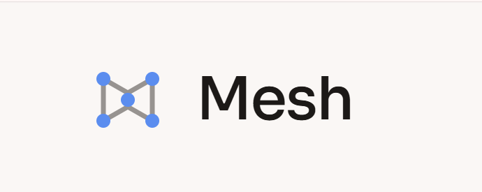
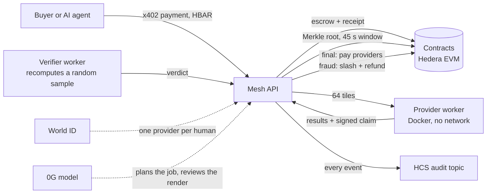

<p align="center">
  
</p>

<h3 align="center">Spare compute you can prove.</h3>

<p align="center">
  A marketplace where anyone can lend an idle computer and anyone can buy compute, and the chain, not trust, decides who is telling the truth.
</p>

<p align="center">
  <a href="https://mesh-592g.onrender.com"><b>Live app</b></a> ·
  <a href="https://drive.google.com/file/d/1wpvOOErLR30L2QT_l0BdOiN8Uk6OQVxn/view?usp=sharing"><b>Demo video</b></a> ·
  <a href="docs/README.md">Docs</a> ·
  <a href="docs/TRACKS.md">Prize tracks</a>
</p>

<p align="center">
  
  
  
  
  
</p>

## The problem

Renting your computer to a stranger, or renting a stranger's, only works if you can tell a real answer from a fake one. Today that means trusting a platform. Mesh replaces the platform with checks anyone can reproduce: a provider **commits** to its answers on chain, a random sample is **recomputed after the commitment**, and a provider caught lying is **slashed** while the buyer is refunded in the same transaction.

> The chain does not exist to move the fee. It exists to prove what ran, punish a lie, and leave a receipt anyone in the world can check.

## Try it in two minutes

1. Open **https://mesh-592g.onrender.com** (the first load can be slow if the server was idle).
2. **Connect a wallet** (MetaMask or any EVM wallet) and sign the login message. No transaction, no gas.
3. **Deposit** at least 0.01 HBAR on Hedera Testnet. Mesh verifies the transfer on chain, credits your prepaid balance once, and issues a receipt.
4. Ask the **Mesh agent** for a small render. A 0G model plans the job, the agent pays over x402 from your credit, and a real provider renders the 64 tiles live.
5. Open the **job page**: tiles arrive as they are computed, then a 45 second challenge window runs while the verifier recomputes a sample. The receipt links the contract, the x402 payment on HashScan and the HCS audit log.

Use a wallet that is not the agent's own account (the app disables self-deposits). Network settings for MetaMask: Hedera Testnet, RPC `https://testnet.hashio.io/api`, chain ID `296`, symbol `HBAR`, explorer https://hashscan.io/testnet. A provider (an operator's laptop with Docker) is online on the live site. The demo video shows the provider side: the worker, Docker and the verifier.

## How it works



1. **Pay.** A requester posts a job and pays through **x402 on Hedera**. The settled payment goes to a treasury account and the escrow contract mirrors it.
2. **Compute.** The job (a tiled render) is split into 64 tiles and run by staked providers inside Docker, offline, from a pinned image digest.
3. **Commit.** Each provider signs a claim over its tile hashes. The API commits a **Merkle root** of all tiles on chain, which opens a 45 s **challenge window**.
4. **Verify.** A verifier recomputes a random, seeded sample of tiles. A wrong tile produces a **fraud proof**: the provider is **slashed** and the requester **refunded**. Otherwise the receipt becomes **final** and providers are paid.
5. **Review.** A vision model on **0G** reviews each finished render and the job page shows its request ID and how it was verified ([docs/OG-STATUS.md](docs/OG-STATUS.md)). The review is advisory and never decides payment.
6. **Audit.** **World ID** keeps it to one provider profile per human. Every state change is also published to a **Hedera Consensus Service** topic.

Exact formats and interfaces are in [docs/job-spec.md](docs/job-spec.md).

## Partner tracks

| Track | What we use it for | Code |
| --- | --- | --- |
| **Hedera** | x402 v2 payments (`@x402/hedera`, exact scheme) from a buyer or an AI agent's prepaid credit; stake and deposits read back from Hedera; every event published to an HCS topic | [`x402.ts`](src/lib/x402.ts), [`agent.ts`](src/lib/agent.ts), [`hcs.ts`](src/lib/hcs.ts) |
| **World** | IDKit proof of human for provider registration; nullifiers stored and enforced on chain, so one human gets one provider profile; human approval of large agent spends | [`world-verify.tsx`](src/components/world-verify.tsx), [`MeshStake.sol`](contracts/src/MeshStake.sol) |
| **0G** | A 0G model plans each job from the user's words and reviews the finished render, with `verify_tee`, the Router request ID and a signature check on every call | [`og.ts`](src/lib/og.ts) |

Feedback for each sponsor: [Hedera](docs/FEEDBACK-hedera.md), [World](docs/FEEDBACK-world.md), [0G](docs/OG-STATUS.md).

## Live on Hedera testnet (chain ID 296)

| Contract | Address |
| --- | --- |
| MockStable (test payment token) | [`0x9009A5B2070a97aAa81c6EB77A2507273Ba46Ee3`](https://hashscan.io/testnet/contract/0x9009A5B2070a97aAa81c6EB77A2507273Ba46Ee3) |
| MeshStake | [`0x522C2eef0EF65d1f9eA9dfe12b88ba24565245f8`](https://hashscan.io/testnet/contract/0x522C2eef0EF65d1f9eA9dfe12b88ba24565245f8) |
| MeshEscrow | [`0x16eFE46De1CdA06Be455607A63514319aE130010`](https://hashscan.io/testnet/contract/0x16eFE46De1CdA06Be455607A63514319aE130010) |
| MeshReceipt | [`0x0118652ea87a8616Cb51979F5F121FC598bf3e7E`](https://hashscan.io/testnet/contract/0x0118652ea87a8616Cb51979F5F121FC598bf3e7E) |

Challenge window 45 s, minimum stake 0.5 HBAR, slash 0.2 HBAR ([docs/DEPLOY.md](docs/DEPLOY.md)).

**Settled x402 payments** from the agent account `0.0.11333706` to the treasury `0.0.11327733`, through the official x402 facilitator:

| Transaction | Amount | HashScan |
| --- | --- | --- |
| `0.0.9185802@1793937163.341350400` | 0.5 HBAR | [view](https://hashscan.io/testnet/transaction/0.0.9185802-1793937163-341350400) |
| `0.0.9185802@1793941137.019516163` | 0.1 HBAR | [view](https://hashscan.io/testnet/transaction/0.0.9185802-1793941137-019516163) |

**Audit log:** HCS topic [`0.0.11333951`](https://hashscan.io/testnet/topic/0.0.11333951).

**How an x402 payment works.** The agent posts a job; the API answers `402` with a price in HBAR on `hedera:testnet`; the agent signs a Hedera transfer and retries; the facilitator verifies and settles it (and pays the network fee); only then is the job created. A signed payment works once. Above a spending threshold the agent must first get a human approval in World for that exact job.

## Built with

Next.js 16 and React 19 · TypeScript · Tailwind · SQLite (`node:sqlite`) · Solidity and Foundry (67 tests) · viem and wagmi · `@hiero-ledger/sdk` · `@x402/core` and `@x402/hedera` · `@worldcoin/idkit` · 0G Router · Docker · Vitest · Render

## Run it yourself

Requires Node.js 24 and npm. Docker Desktop is needed on a provider machine, and Foundry only for the contracts.

```bash
npm install
cp .env.example .env     # fill in your own values; .env is git-ignored
npm run dev              # http://localhost:3000
```

| Command | What it does |
| --- | --- |
| `npm run build` / `npm start` | Production build and server (use this to review the site) |
| `npm test` / `npm run typecheck` / `npm run lint` | Vitest suite and static checks |
| `npm run worker:provider` | Provider worker (runs tiles in Docker) |
| `npm run worker:verifier` | Verifier worker (recomputes the sample) |
| `npm run agent -- small` | Scripted agent: pays over x402 and follows one job |
| `npm run chain:local` | Local anvil chain with contracts and staked providers, free to rehearse ([docs/LOCAL-REHEARSAL.md](docs/LOCAL-REHEARSAL.md)) |
| `cd contracts && forge test` | Contract tests |

Setting `MESH_TAMPER=true` makes a provider cheat on purpose, so the detect, slash and refund path can be shown live. Private keys and API secrets belong only in your local `.env`.

## Repository

```
src/app/         Next.js pages (landing, /app, /docs, /jobs, /provider, /approve) and API routes
src/lib/         core logic: jobs, claims, chain loop, x402, agent, HCS, World, 0G, verifier, db
src/components/  React components
workers/         provider, verifier and mock-provider processes
contracts/       Foundry project: MeshStake, MeshEscrow, MeshReceipt
jobs/            Docker job images
docs/            specs, deployment, QA, track notes and feedback
```

More: [job spec](docs/job-spec.md) · [provider protocol](docs/PROVIDER-PROTOCOL.md) · [hosting](docs/HOSTING.md) · [QA results](docs/QA.md)

## Honest limits

- Verification is **optimistic**: a claim is pending for a challenge window, and a single Mesh verifier key decides fraud claims. It can only finalize or reject, and every decision is public and reproducible.
- Sampling is probabilistic. A provider that corrupts one tile of 64 is usually missed; detection rises fast with more bad tiles ([docs/QA.md](docs/QA.md)).
- The escrow contract mirrors the x402 payment with a test token. Real token escrow needs a contract redeploy.
- A provider can see the job inputs, and Docker is not a hard security boundary.
- A 0G TEE signature proves where an output came from, not which prompt produced it. The AI review is advisory and can be wrong. When the signature cannot be checked, the UI says "not verified".
- World ID staging proofs use test identities, so this is not production Sybil resistance. Approvals may use an IDKit proof instead of the World IdP client.
- Test network, test funds, no outside audit. Do not use real money.

## Team

Built from scratch at **ETHGlobal Mumbai 2026** by **Misbah Ansari** and **Anurag Dubey**. No pre-existing project code was reused. AI assistance is documented in [docs/AI.md](docs/AI.md).
